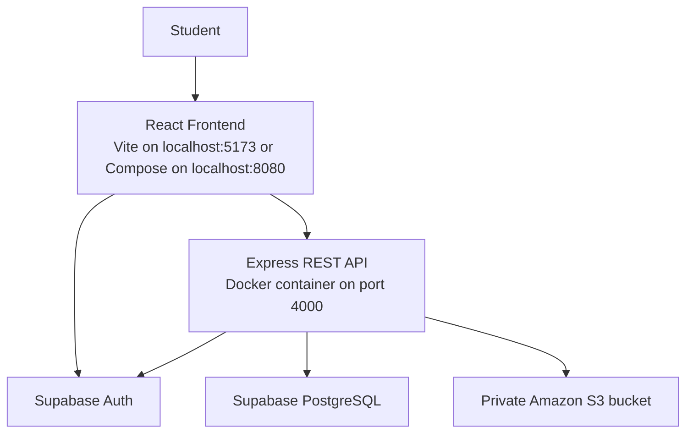

# FindIt@Thapar

A campus-focused lost-and-found web application that helps students report lost items, share found items, and manage their listings.

## Features

- User authentication using Supabase Auth
- Create lost and found listings
- Browse and search item listings
- Filter listings by relevant attributes
- View personal listings
- Edit and delete your own listings
- Mark listings as resolved
- Ownership checks for listing management
- Upload, replace, and remove listing photos (JPEG, PNG, or WebP up to 5 MB)

## Technology Stack

| Component | Technology | Purpose |
|---|---|---|
| Frontend | React, Vite, CSS | User interface |
| Backend | Node.js, Express | REST API and application logic |
| Database | Supabase PostgreSQL | Store item listings |
| Authentication | Supabase Auth | User authentication |
| Image storage | Private Amazon S3 | Store listing photos; the API issues short-lived viewing URLs |
| Containerization | Docker | Package and run the frontend and backend consistently |
| Version control | Git, GitHub | Track and share source code |

## System Architecture



The frontend communicates with Supabase for authentication and with the Express API for backend operations. The API validates user access and uses Supabase to access item data.

Docker Compose can build and run both the frontend and backend. The frontend can also run separately using Vite during development.

## Project Structure

```text
FindIt-at-Thapar/
├── backend/
│   ├── src/
│   │   ├── lib/
│   │   ├── routes/
│   │   └── server.js
│   ├── .dockerignore
│   ├── .env.example
│   ├── Dockerfile
│   └── package.json
├── frontend/
│   ├── src/
│   ├── .env.example
│   └── package.json
├── .gitignore
└── README.md
```

## Prerequisites

- Node.js and npm
- Docker Desktop
- A configured Supabase project
- Git

## Configuration

### Backend

Create `backend/.env` using `backend/.env.example` as a reference. Both the Docker Compose workflow and the standalone backend container read this file for backend settings and the server-only Supabase secret key.

Configure these variables with your own values:

```dotenv
PORT=4000
FRONTEND_ORIGIN=http://localhost:5173
SUPABASE_URL=your_supabase_project_url
SUPABASE_SECRET_KEY=your_supabase_secret_key
AWS_REGION=ap-southeast-2
S3_BUCKET=your-private-image-bucket-name
```

The backend uses the AWS SDK default credential chain. For local Docker Compose access to an existing bucket, make credentials available to the backend container through its ignored `backend/.env` file (for example, `AWS_ACCESS_KEY_ID`, `AWS_SECRET_ACCESS_KEY`, and an optional `AWS_SESSION_TOKEN`). Never commit those values. In production, use an EC2 instance role scoped to the image bucket and omit static keys. The bucket must remain private with S3 Block Public Access enabled. Do not put AWS credentials or image URLs in frontend environment files. Without `S3_BUCKET` and working AWS credentials, listings remain usable but image endpoints report that storage is unavailable.

Before running the updated API, apply the checked-in SQL migration `supabase/migrations/20261019000000_add_items_image_object_key.sql` to the intended Supabase project. This repository does not apply database migrations automatically.

### Frontend

Create `frontend/.env` using `frontend/.env.example` as a reference. It contains the API URL, Supabase project URL, and Supabase publishable key required by the frontend. The publishable key is used in the browser; never put the backend secret key in this file.

**Security:** Never commit real `.env` files or secret keys to GitHub. Keep the backend Supabase secret key server-side only.

## Running the Application

Choose one of these local workflows. Run commands from the project root unless stated otherwise.

### Docker Compose

Create `backend/.env` and `frontend/.env` from their respective example files, then fill in your local Supabase project URL and keys. Compose reads backend settings from `backend/.env`; pass `frontend/.env` explicitly so Compose can use its values as frontend build arguments:

```bash
docker compose --env-file frontend/.env up --build
```

The frontend is available at http://localhost:8080 and the API at http://localhost:4000. The API URL defaults to `http://localhost:4000`; override `VITE_API_URL` in `frontend/.env` if needed. Compose sets the backend CORS origin to `http://localhost:8080` for this workflow. The two Supabase frontend build arguments are required; Compose reports which value is missing if either is unset.

Stop the stack with `Ctrl+C`, or run `docker compose down` from another terminal.

### Vite development frontend and Docker backend

Create `backend/.env` and `frontend/.env` from their respective example files. Run the backend container as described below, then start Vite:

#### 1. Build the backend Docker image

```bash
docker build -t findit-backend ./backend
```

#### 2. Start the backend container

```bash
docker run --name findit-api \
  --env-file backend/.env \
  -p 4000:4000 \
  findit-backend
```

Keep this terminal open while the container is running.

If a container named `findit-api` already exists, stop and remove it before recreating it:

```bash
docker stop findit-api
docker rm findit-api
```

Then run the start command again. Rebuild the image first if you have changed the backend source code or Dockerfile.

#### 3. Verify the backend

Open another terminal and run:

```bash
curl http://localhost:4000/api/health
```

Expected response:

```json
{
  "status": "ok",
  "service": "FindIt@Thapar API"
}
```

#### 4. Start the frontend

Open another terminal:

```bash
cd frontend
npm install
npm run dev
```

Open the local URL printed by Vite, usually:

http://localhost:5173

Keep the frontend development server and backend container running while testing the application.

## Docker Implementation

The backend Dockerfile uses a Node.js Alpine base image, installs production dependencies, copies the backend source code, and starts the Express server. The frontend Dockerfile builds the Vite application and serves the static files with Nginx. Docker Compose runs both services together. Supabase continues to provide hosted authentication and database services.

## Current Deployment Status

- Frontend and backend can run together with Docker Compose, or the frontend can run through Vite with the backend in Docker.
- Supabase provides authentication and database services.
- The project source code is managed using Git and GitHub.
- Deployment to AWS or another cloud hosting platform is a future step.

## Future Improvements

- Deploy the backend container to a cloud server.
- Host the frontend on a cloud static-hosting service.
- Configure production environment variables and HTTPS.
- Add automated testing and continuous deployment.

## Academic Project

**Project:** FindIt@Thapar  
**Purpose:** A digital lost-and-found platform for the campus community.

