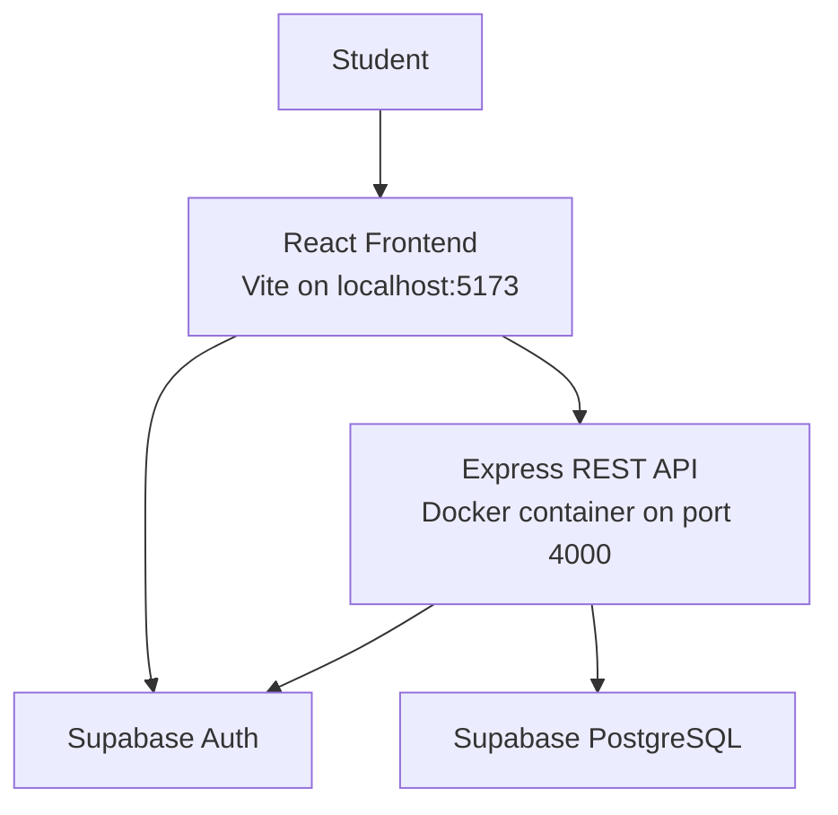

# FindIt@Thapar

A campus-focused lost-and-found web application that helps students report lost items, share found items, and manage their listings.

## Features

- User authentication using Supabase Auth
- Create lost and found listings
- Browse and search item listings
- Filter listings by relevant attributes
- View personal listings
- Edit and delete your own listings
- Mark listings as resolved
- Ownership checks for listing management

## Technology Stack

| Component | Technology | Purpose |
|---|---|---|
| Frontend | React, Vite, CSS | User interface |
| Backend | Node.js, Express | REST API and application logic |
| Database | Supabase PostgreSQL | Store item listings |
| Authentication | Supabase Auth | User authentication |
| Containerization | Docker | Package and run the backend consistently |
| Version control | Git, GitHub | Track and share source code |

## System Architecture



The frontend communicates with Supabase for authentication and with the Express API for backend operations. The API validates user access and uses Supabase to access item data.

Docker packages the Express backend and its production dependencies. The frontend currently runs separately using Vite.

## Project Structure

```text
FindIt-at-Thapar/
├── backend/
│   ├── src/
│   │   ├── lib/
│   │   ├── routes/
│   │   └── server.js
│   ├── .dockerignore
│   ├── .env.example
│   ├── Dockerfile
│   └── package.json
├── frontend/
│   ├── src/
│   ├── .env.example
│   └── package.json
├── .gitignore
└── README.md
```

## Prerequisites

- Node.js and npm
- Docker Desktop
- A configured Supabase project
- Git

## Configuration

### Backend

Create `backend/.env` using `backend/.env.example` as a reference.

Configure these variables with your own values:

```dotenv
PORT=4000
FRONTEND_ORIGIN=http://localhost:5173
SUPABASE_URL=your_supabase_project_url
SUPABASE_SECRET_KEY=your_supabase_secret_key
```

### Frontend

Create `frontend/.env` using `frontend/.env.example` as a reference. Set the Supabase URL and publishable key required by the frontend.

**Security:** Never commit real `.env` files or secret keys to GitHub. Keep the backend Supabase secret key server-side only.

## Running the Application

Run the following commands from the project root unless stated otherwise.

### 1. Build the backend Docker image

```bash
docker build -t findit-backend ./backend
```

### 2. Start the backend container

```bash
docker run --name findit-api \
  --env-file backend/.env \
  -p 4000:4000 \
  findit-backend
```

Keep this terminal open while the container is running.

If a container named `findit-api` already exists, stop and remove it before recreating it:

```bash
docker stop findit-api
docker rm findit-api
```

Then run the start command again. Rebuild the image first if you have changed the backend source code or Dockerfile.

### 3. Verify the backend

Open another terminal and run:

```bash
curl http://localhost:4000/api/health
```

Expected response:

```json
{
  "status": "ok",
  "service": "FindIt@Thapar API"
}
```

### 4. Start the frontend

Open another terminal:

```bash
cd frontend
npm install
npm run dev
```

Open the local URL printed by Vite, usually:

http://localhost:5173

Keep the frontend development server and backend container running while testing the application.

## Docker Implementation

The backend Dockerfile uses a Node.js Alpine base image, installs production dependencies, copies the backend source code, and starts the Express server.

Docker provides a repeatable environment for running the backend. In the current development setup, the frontend runs through Vite and Supabase provides hosted authentication and database services.

## Current Deployment Status

- Frontend runs locally using Vite.
- Backend runs locally in a Docker container.
- Supabase provides authentication and database services.
- The project source code is managed using Git and GitHub.
- Deployment to AWS or another cloud hosting platform is a future step.

## Future Improvements

- Deploy the backend container to a cloud server.
- Host the frontend on a cloud static-hosting service.
- Configure production environment variables and HTTPS.
- Add automated testing and continuous deployment.

## Academic Project

**Project:** FindIt@Thapar  
**Purpose:** A digital lost-and-found platform for the campus community.

